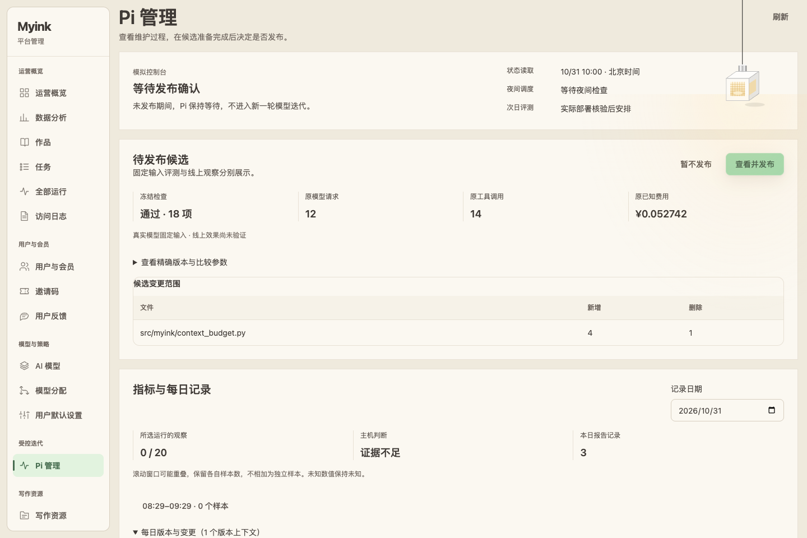
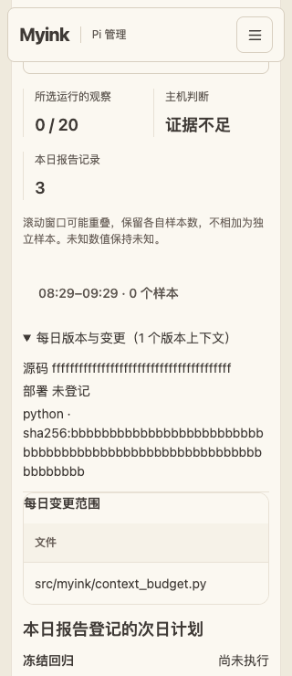

# Pi 合入 main 与管理员控制台验收记录（2026-10-31）

## 交付范围

本轮将 Pi 长期分支与最新 main 合并到管理员分支，新增 `/admin/pi`，最终按用户授权合入 main。管理员可阅读阶段、调度、指标样本与证据不足判断、模型建议、工具输入/结果摘要和计数、每日版本/文件变更、次日计划及其真实结果；可对当前精确候选确认发布或记录暂不发布。

状态和审计沿用原 Pi Gate、任务/费用账本和审计导出。产品 API 每次重新核验管理员会话并写访问审计，才访问固定 Unix socket；它只拿本地服务 token，不持有 Docker socket、Pi 模型凭据或原账本。浏览器不能传 actor_id、路径或命令。宿主仅对当前轮次及四个匹配摘要执行，先落审计再派发，拒绝重复并发、陈旧候选和自动重放。宿主中断保留待人工核对状态。

人工确认后，发布器复核运行容器与 Compose 的 hash/环境/命令/挂载，复用原 PostgreSQL 维护行 CAS 关闭 admission/consumer，再复查未落定 intake/outbox、执行者、活动任务和队列。只有 API + 两个 worker 的镜像被替换；完整物理核验后同步原维护行的部署身份，再开放业务。关闭后的未知失败保持屏障关闭并留下回执，不自动恢复账本或数据库。

该通道发布本地不可变镜像；GitHub 源码推送独立处理。候选源码通过真实私有 Git 对象保留，并验证完整 Python 包字节一致，不把镜像标签当源码证明。每轮不发布就长期等待；实际部署核验后按部署日的次日北京时间 03:00 登记回归和指标观察。

## 独立审查与修复

一次独立源码审查发现并修复四项问题：发布前无 PG 屏障/发布后未同步身份、预存在的 Compose 漂移可被接受、轮询失败后刷新仍保留陈旧操作、当前运行借用了其他运行的样本。每项使用失败用例验证后修复。人工浏览验收另发现展开版本表导致窄屏内部撑宽，新增内部容器宽度断言并修复。

完整浏览器回归还修复两个测试时序：关闭游客弹窗后等待真实卸载，再检查焦点刷新不会重开；SSE 场景按正文和章节的完成状态等待，不把持久连接的 networkidle 当完成条件。没有为此改变业务页面逻辑。

## 已完成验证

- 真实 JWT + 隔离 PostgreSQL + 真实本地 Unix socket 的管理员/契约针对回归：87 通过。其中两个独立临时 PG 数据库用例验证原维护行 CAS、身份切换、重开，以及已获准请求在屏障关闭前后提交的竞态；临时数据库已清理。
- 宿主发布与控制台针对回归：65 通过。Docker 发布效果为 SIMULATED，Git 对象是真实临时 Git 仓库。
- 前端共享逻辑：209 通过；Vue：835 通过；严格类型检查、lint、生产构建通过。lint 剩余 9 个既有多组件警告，无错误。
- Pi Node 控制工具/线协议：54 通过。前端资产/默认入口/浏览器清理回归：10 通过。公开旧资产提取失败路径：4 通过。评测清单：20 审计案例、40 目录项，以及 retrieval 8、comparison 2 校验通过。
- Chromium / Firefox / WebKit 的 24 个阶段组合取得通过回执：首轮 22 项通过，另外两项修复后单独复测通过。原失败回执保留，汇总在 `/private/tmp/myink-pi-main-matrix-final.json`；所有浏览器 API 都是明确的 loopback 合成 fixture，无真实用户、宿主发布或模型调用。
- Compose 真实解析确认 socket/token 仅由 API 只读挂载，不自动创建宿主路径，worker 不挂载，产品没有 Docker socket。
- 闭合宿主 runtime：416 文件，SHA-256 `ad4a93019c298289acd5f0f0da8cff3a498b40bb18df300b02f21932a19642fb`，来源提交 `334bd305f6f145363750c02d6272f1a7c48407b0`。已用本地实际所有者验证全部清单与文件；尚未以 Linux root 安装。

最终全量原始结果与失败复测：

- Python 全量：2,661 通过、1 失败、1 跳过、2 预期失败、159 排除，另有 2 个 subtest 通过。唯一失败是 VIP 双 worker 测试在高负载下未于 20 秒收齐 104 条回执；随后整份真实 RabbitMQ/Redis worker 集成文件独立复测 **5 通过**（61.04 秒），未修改 VIP 生产代码或断言。首次全量同一场景也通过。
- Pi 全量：4,488 通过、1 失败、63 排除。唯一失败来自旧排空测试把 native fake CLI 启动也限定为 200ms，先触发命令超时而不是预期的队列截止时间。仅将该测试的排空时钟改为确定性截止，原生命令仍保留真实有限超时，并精确断言 backlog 原因、worker 不停、消息不丢；整份原生 runtime 测试复测 **27 通过**（40.05 秒）。生产实现不变。此前完整基线 4,485 项通过。
- 明确跳过：`test_evaluation_comparison_integration.py::test_direct_full_and_ablation_preserve_all_outputs_and_persisted_body`，需要单独批准的 localhost:15432 评测库身份；本轮使用的是 16432 专用隔离库，未绕过此隔离守卫。不把该跳过或未运行的付费/实验测试当作通过。
- Pi 分支提交 `79925f791a9f28ee5037caadb51354d0c8c39ee3` 的 [远程 CI 四个任务全部通过](https://github.com/frostloom/Myink/actions/runs/41173146308)。合入后的 main 必须继续核对精确提交的 CI；最终交付给出对应回执，不能用这次 Pi 回执替代 main。

本地构建产物来源 `7e9679293a0d765f2662f9d2558d9327ed6364a0`，[完整镜像/包/前端身份清单](pi-admin-artifacts-2026-10-31.json)：API 与 Caddy label 一致，Python 镜像 155 个源文件与 Git 完全匹配，128 条 OpenAPI 路径，Caddy index 与本次浏览器验收构建字节一致，Caddy 配置校验成功。**本地镜像架构是 arm64，生产宿主只读核对为 x86_64；这些镜像用于本地构建验证，不能直接部署到该生产宿主。** 生产发布仍需以已确认提交构建/核验 amd64 镜像。闭合 Python runtime 本身为纯 Python 源及 vendor 文件。

## 页面留样（合成数据）

## 生产边界

合入/推送 main 不等于服务器已更新。新产品镜像、root 宿主桥接服务、只读 socket 挂载和可信 Git bundle 的生产安装尚未执行；ACTUAL Linux peer 身份、systemd 沙箱与真正 Docker 替换需要在明确批准的部署中验证。发布通道初次配置为只读核对，不能仅因配置完成就批准任意候选。

操作配置、原账本路径、核验顺序、回执位置和人工处理说明见 [部署运行手册](../pi/admin-console.md)。本轮开发和验证没有新增真实模型请求或费用，也没有改变原 50 元授权或释放历史未知费用。原线上次日评测与真实样本仍按实际时间等待，不以本轮离线/合成验证冒充线上收益。
